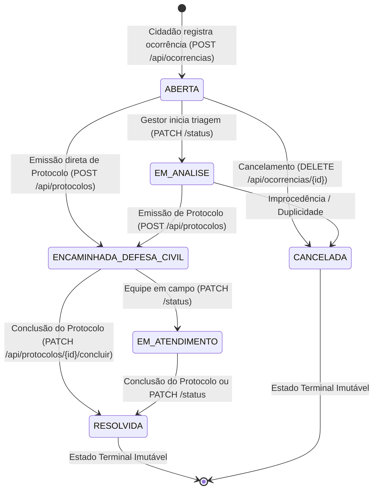

# 🚨 AlertaCom API — Plataforma CitizenTech de Resiliência Urbana e Defesa Civil


> **Global Solution 2026/2 — FIAP | Disciplina: Java Advanced**  
> **Tema:** CitizenTech — Tecnologia Cidadã para Resiliência Climática e Zeladoria Urbana  
> **Curso:** Análise e Desenvolvimento de Sistemas (FIAP — Turma 2TDSR)  
> **Integrantes do Grupo:**  
> - **Gabriel Maciel Alves de Oliveira** — RM 562795  
> - **Thomas Fontes** — RM 562254  
> - **Vitória Rodrigues Martins** — RM 565160  
> - **Matheus Pereira Molina** — RM 563399

---

## 📑 Sumário

1. [Visão Geral da Solução CitizenTech](#-1-visão-geral-da-solução-citizentech)
2. [Alinhamento ESG (ODS 11 e ODS 13) & Modelo B2G](#-2-alinhamento-esg-ods-11-e-ods-13--modelo-b2g)
3. [Checklist de Conformidade FIAP (100 Pontos)](#-3-checklist-de-conformidade-fiap-100-pontos)
4. [Arquitetura Corporativa & Fluxo de Dados](#-4-arquitetura-corporativa--fluxo-de-dados)
5. [Modelo de Domínio JPA & Máquina de Estados](#-5-modelo-de-domínio-jpa--máquina-de-estados)
6. [Segurança Stateless JWT & Matriz RBAC](#-6-segurança-stateless-jwt--matriz-rbac)
7. [Mensageria Assíncrona com RabbitMQ](#-7-mensageria-assíncrona-com-rabbitmq)
8. [Inteligência Artificial Preventiva (Spring AI Dual-Engine)](#-8-inteligência-artificial-preventiva-spring-ai-dual-engine)
9. [Catálogo Completo de Endpoints REST](#-9-catálogo-completo-de-endpoints-rest)
10. [Guia Prático de Requisições (`curl`)](#-10-guia-prático-de-requisições-curl)
11. [Como Executar o Projeto (Local H2 & Docker Compose)](#-11-como-executar-o-projeto-local-h2--docker-compose)
12. [Acesso às Interfaces (Swagger UI, H2 Console e RabbitMQ)](#-12-acesso-às-interfaces-swagger-ui-h2-console-e-rabbitmq)
13. [Execução da Suíte de Testes Automatizados (Unitários & E2E)](#-13-execução-da-suíte-de-testes-automatizados-unitários--e2e)
14. [Estrutura de Diretórios do Projeto](#-14-estrutura-de-diretórios-do-projeto)

---

## 🌍 1. Visão Geral da Solução CitizenTech

O **AlertaCom** é uma plataforma backend corporativa desenvolvida em **Java 21 LTS** com **Spring Boot 3.3.5**, projetada sob o paradigma **CitizenTech**: **transformar cada cidadão em um sensor ativo e inteligente da cidade**.

Todos os anos, eventos climáticos extremos — tempestades severas, inundações bruscas, deslizamentos de encostas e quedas de árvores — paralisam centros urbanos brasileiros e colocam milhares de vidas em risco. O principal gargalo operacional das prefeituras e coordenadorias de Defesa Civil não é apenas o volume pluviométrico, mas a **assimetria de informação em tempo real** entre o ponto focal da ocorrência e as equipes de resposta tática.

O **AlertaCom** elimina esse gargalo conectando o relato georreferenciado do cidadão diretamente à malha operacional do município:
- **Triagem Transacional & Georreferenciada:** Munícipes registram incidentes de risco (`ALAGAMENTO`, `BUEIRO_OBSTRUIDO`, `DESLIZAMENTO`, `QUEDA_ARVORE`, `ENXURRADA`, `EROSAO_SOLO`) com coordenadas precisas (`latitude`/`longitude`) e nível de severidade (`BAIXA`, `MEDIA`, `ALTA`, `CRITICA`).
- **Acionamento Tático em Milissegundos via RabbitMQ:** Ocorrências classificadas como `ALTA` ou `CRITICA` disparam automaticamente eventos assíncronos AMQP para a fila prioritária da Defesa Civil (`alertas.criticos.queue`), desacoplados da transação JPA via `@TransactionalEventListener(phase = TransactionPhase.AFTER_COMMIT)`, garantindo resposta imediata sem risco de falsos alertas em caso de rollback e sem bloquear a requisição HTTP do cidadão.
- **Despacho Auditável de Protocolos Oficiais:** Gestores públicos (`ROLE_GESTOR`) emitem protocolos formais da Defesa Civil (`DEF-YYYY-NNNNN`) com geração concorrente atômica via sequence relacional, acompanham o ciclo de vida completo da ocorrência e registram pareceres técnicos de encerramento.
- **Inteligência Artificial Preventiva no Fluxo do Negócio (Spring AI):** Em vez de um chat genérico desacoplado, o AlertaCom agrega as ocorrências reais abertas em determinado bairro direto do banco de dados e utiliza **Spring AI** (com arquitetura *Dual-Engine*: OpenAI GPT + Motor Determinístico de Contingência Offline) para gerar **Boletins Preventivos Municipais** com nível de risco consolidado, pontos críticos a evitar, recomendações à população e plano tático para a Defesa Civil.

---

## 🌱 2. Alinhamento ESG (ODS 11 e ODS 13) & Modelo B2G

### Objetivos de Desenvolvimento Sustentável da ONU (Agenda 2030)
| ODS | Meta | Como o AlertaCom entrega impacto mensurável |
| :--- | :--- | :--- |
| **ODS 11 — Cidades e Comunidades Sustentáveis** | **Meta 11.5:** Reduzir significativamente o número de mortes e o número de pessoas afetadas por catástrofes urbanas, protegendo populações vulneráveis. | Democratiza o canal de comunicação de emergência para bairros periféricos, reduzindo o tempo entre o avistamento de um risco estrutural (ex: trinca em talude ou bueiro obstruído) e a intervenção das equipes de zeladoria e salvamento. |
| **ODS 13 — Ação Contra a Mudança Global do Clima** | **Meta 13.1:** Reforçar a resiliência e a capacidade de adaptação a riscos relacionados ao clima e às catástrofes naturais. | Combina sensoriamento comunitário (*crowdsensing*) com inteligência artificial generativa (**Spring AI**) para transformar relatos brutos de campo em boletins preditivos e planos de contingência hiperlocais por bairro. |

### Modelo de Negócios B2G (*Business-to-Government*)
O **AlertaCom** opera como uma plataforma **SaaS B2G** licenciada para **Prefeituras Municipais, Subprefeituras, Secretarias de Zeladoria/Obras e Coordenadorias de Defesa Civil**:
- **Assinatura Mensal/Anual Escalonada por Porte Populacional:** Planos *Município Resiliente* (até 100 mil hab.), *Metrópole Conectada* (100 mil a 1 milhão hab.) e *Consórcio Intermunicipal / Estadual*.
- **Retorno sobre Investimento Público (ROI Social 7:1):** Estudos internacionais de gestão de riscos demonstram que cada **R\$ 1,00 investido em zeladoria preventiva e alerta precoce economiza até R\$ 7,00** em reconstrução emergencial de infraestrutura viária, atendimento hospitalar e indenizações judiciais por danos materiais.
- **Zero Custo de Hardware Proprietário:** Substitui a necessidade de implantar milhares de sensores IoT físicos de alto custo de manutenção pela capilaridade dos smartphones dos próprios cidadãos auditados pela plataforma.

---

## 🏆 3. Checklist de Conformidade FIAP (100 Pontos)

| # | Requisito Avaliado | Peso | Implementação no AlertaCom |
| :---: | :--- | :---: | :--- |
| **01** | **API REST do Domínio** | **20 pts** | 3 entidades JPA relacionadas (`Cidadao` 1:N `Ocorrencia` 1:1 `ProtocoloDefesaCivil`), mapeamento compatível com Oracle 23c e H2 (`MODE=Oracle`), CRUD completo, sequence atômica `SEQ_PROTOCOLO_NUMERO` contra concorrência e paginação nativa (`Pageable` / `Page<T>`). |
| **02** | **Validação e Tratamento de Erros** | **10 pts** | Jakarta Bean Validation (`@Valid`, `@NotBlank`, `@NotNull`, `@Email`, `@Pattern`, `@DecimalMin`, `@DecimalMax`, `@Future`, `@Size`) em todos os DTOs + `GlobalExceptionHandler` (`@RestControllerAdvice`) padronizado segundo a **RFC 7807 (`ProblemDetail`)**. |
| **03** | **Segurança com JWT & RBAC** | **20 pts** | Spring Security 6 Stateless com tokens JWT assinados via **Auth0 java-jwt (HMAC256)**, senhas com `BCryptPasswordEncoder`, segregação estrita entre `ROLE_CIDADAO` e `ROLE_GESTOR`, forçamento incondicional de `ROLE_CIDADAO` no cadastro público, eliminação definitiva de backdoors no `SecurityFilter`, validação fail-fast de entropia do `JWT_SECRET` (mínimo 256 bits / 32 caracteres), proteção contra IDOR em Cidadão e Ocorrência, e matriz restrita de Actuator (`health`/`info` públicos) e H2 Console (`dev` only). |
| **04** | **Spring AI Integrada ao Negócio** | **20 pts** | Endpoint `POST /api/relatorios/boletim-bairro` (e alias `POST /api/boletim/preventivo`) que consulta as ocorrências reais do bairro no banco JPA e sintetiza Boletim Preventivo estruturado com arquitetura **Dual-Engine** (OpenAI + Fallback Determinístico Offline). |
| **05** | **Arquitetura Distribuída (RabbitMQ)** | **20 pts** | Publicação assíncrona resiliente na exchange `alerta.exchange` (`routingKey: alerta.critico.<bairro>`) desacoplada via `@TransactionalEventListener(phase = AFTER_COMMIT)` para ocorrências `ALTA`/`CRITICA`, serialização JSON (`Jackson2JsonMessageConverter`) e consumo automático via `@RabbitListener` na fila `alertas.criticos.queue`. |
| **06** | **Documentação & Integração Docker** | **10 pts** | `OpenApiConfig` com **SpringDoc OpenAPI 2.6.0** (`/swagger-ui.html`) configurado com esquema Bearer JWT, `Dockerfile` multi-stage com `HEALTHCHECK` funcional no Actuator, `.dockerignore` higienizado, template `.env.example`, `docker-compose.yml` (Oracle 23c + RabbitMQ Management), pipeline de CI no **GitHub Actions** (`.github/workflows/ci.yml`), `README.md` e `ROTEIRO_PITCH_5MIN.md`. |
| | **TOTAL** | **100 pts** | **100% dos requisitos técnicos e de negócio implementados, blindados e testados.** |

---

## 🏛️ 4. Arquitetura Corporativa & Fluxo de Dados

### Diagrama de Arquitetura (Mermaid)

```mermaid
flowchart TD
    subgraph Clientes["📱 Camada de Apresentação & Clientes"]
        CID["Cidadão (App Mobile / Web)\nROLE_CIDADAO"]
        GES["Gestor Público / Defesa Civil\nROLE_GESTOR"]
        SWG["Swagger UI Interativo\n/swagger-ui.html"]
        ACT["Monitoramento & Telemetria\n/actuator/health | /actuator/**"]
    end

    subgraph Bootstrap["🚀 Inicialização Segura (Seed)"]
        SEED["GestorSeedInitializer\nCommandLineRunner (Idempotente)\ngestor@alertacom.com.br"]
    end

    subgraph API["☕ AlertaCom Backend (Java 21 + Spring Boot 3.3.5)"]
        SEC["Spring Security 6 Filter Chain\nSecurityFilter (Sem Backdoor) + TokenService (JWT 256 bits)\nProteção Ativa contra IDOR & RBAC Estrito"]
        CTRL["REST Controllers\nAuth | Cidadao | Ocorrencia | Protocolo | Boletim"]
        ERR["GlobalExceptionHandler\n@RestControllerAdvice (RFC 7807 ProblemDetail)"]
        SVC["Camada de Serviços de Domínio\nRegras de Negócio & Máquina de Estados"]
        TX["Transação JPA (Commit Relacional)"]
        PUB["AlertaPublisherService\n@TransactionalEventListener(AFTER_COMMIT)\nPublicação Resiliente AMQP"]
        CON["AlertaConsumerService\n@RabbitListener (Broadcast Defesa Civil)"]
        AISVC["BoletimIaService (Spring AI Dual-Engine)"]
    end

    subgraph Mensageria["🐇 Broker Assíncrono (RabbitMQ 3.13)"]
        EX["TopicExchange: alerta.exchange"]
        Q["Queue: alertas.criticos.queue\nRouting Key: alerta.critico.#"]
    end

    subgraph IA["🤖 Motores de Inteligência Artificial"]
        OAI["OpenAI ChatClient (GPT-4o-mini)\nQuando OPENAI_API_KEY válida"]
        MOCK["MockBoletimServiceImpl\nMotor Heurístico Determinístico Offline"]
    end

    subgraph Banco["🗄️ Camada de Persistência Relacional"]
        ORA[("Oracle Database 23c Free\n(Profile: docker)")]
        H2[("H2 In-Memory (MODE=Oracle)\n(Profiles: dev / test)")]
    end

    SEED -.->|Provisiona Gestor Inicial| ORA
    SEED -.->|Provisiona Gestor Inicial| H2
    CID -->|HTTPS + Bearer JWT (ROLE_CIDADAO)| SEC
    GES -->|HTTPS + Bearer JWT (ROLE_GESTOR)| SEC
    SWG -->|OpenAPI 3.0| SEC
    ACT -->|RBAC Guard (Health público / Métricas GESTOR)| SEC
    SEC --> CTRL
    CTRL -.->|Exceções Padronizadas| ERR
    CTRL --> SVC
    SVC --> TX
    TX -->|Spring Data JPA| ORA
    TX -->|Spring Data JPA| H2
    TX -->|Commit Confirmado| PUB
    PUB -->|JSON Message (ALTA / CRITICA)| EX
    EX -->|alerta.critico.<bairro>| Q
    Q -->|Consumo Assíncrono| CON
    CTRL -->|POST /api/relatorios/boletim-bairro| AISVC
    AISVC -->|Consulta Ocorrências do Bairro| ORA
    AISVC -->|Prompt Enriquecido| OAI
    AISVC -->|Fallback Automático Resiliente| MOCK
```

### Diagrama de Arquitetura em Texto (ASCII)

```text
+-----------------------------------------------------------------------------------+
|                   CLIENTE / CIDADÃO (ROLE_CIDADAO) / GESTOR (ROLE_GESTOR)         |
+-----------------------------------------+-----------------------------------------+
                                          |
                                          v
+-----------------------------------------------------------------------------------+
|                     SPRINGDOC OPENAPI 2.6.0 (/swagger-ui.html)                    |
+-----------------------------------------+-----------------------------------------+
                                          |
                                          v
+-----------------------------------------------------------------------------------+
|            SPRING SECURITY 6 FILTER CHAIN (Stateless JWT HMAC-SHA256)             |
|   TokenService (Fail-Fast 256 bits) | SecurityFilter (Validação Estrita no DB)   |
|         Anti-IDOR Protection | Matriz RBAC | Actuator Restrito (/health aberto)   |
+-----------------------------------------+-----------------------------------------+
                                          |
                                          v
+-----------------------------------------------------------------------------------+
|         REST CONTROLLERS (Paginação Nativa Pageable + Jakarta Bean Validation)    |
|   AuthController | CidadaoController | OcorrenciaController | Protocolo | Boletim |
+-------------------+------------------------------+--------------------------------+
                    |                              |
                    v                              v
+-----------------------------------+    +------------------------------------------+
|       SERVICES DE DOMÍNIO         |    |     SPRING AI DUAL-ENGINE SERVICE        |
| Cidadao | Ocorrencia | Protocolo  |    | Agrega ocorrências reais do bairro (JPA) |
+--------+-----------------+--------+    +---------+----------------------+---------+
         |                 |                       |                      |
         v                 v                       v                      v
+-----------------+ +--------------------+ +---------------+  +---------------------+
| SPRING DATA JPA | | TRANSAÇÃO JPA      | | OPENAI CLIENT |  | FALLBACK HEURÍSTICO |
| Sequence Atômica| | (Commit no Banco)  | | (Com API Key  |  | DETERMINÍSTICO      |
| Oracle 23c / H2 | +---------+----------+ |  configurada) |  | (Offline / Zero-Key)|
+-----------------+           |            +---------------+  +---------------------+
                              | @TransactionalEventListener(AFTER_COMMIT)
                              v
                    +--------------------+
                    | RABBITMQ PUBLISHER | -> Publicação segura pós-commit
                    | Severidade:        |    (alerta.exchange -> alertas.criticos.queue)
                    | ALTA / CRITICA     |
                    +---------+----------+
                              |
                              v
                    +--------------------+
                    |  @RabbitListener   | -> Broadcast de Emergência Defesa Civil
                    +--------------------+
```

---

## 🗂️ 5. Modelo de Domínio JPA & Máquina de Estados

### Entidades Relacionais (`src/main/java/br/com/fiap/alertacom/domain/model`)

1. **`Cidadao` (`TB_CIDADAO`)**:
   - Representa tanto o munícipe (`ROLE_CIDADAO`) quanto o agente público/gestor (`ROLE_GESTOR`).
   - Atributos principais: `id`, `nome`, `email` (único), `telefone`, `bairro`, `senha` (hash BCrypt), `role`, `ativo`, `dataCadastro`.
   - Relacionamento: `1:N` com `Ocorrencia` (`@OneToMany(mappedBy = "cidadao")`).
   - **Garantia de Isolamento Cadastral:** O munícipe autenticado só pode consultar e editar seu próprio perfil (`principal.id == id`), prevenindo IDOR. Apenas `ROLE_GESTOR` possui permissão administrativa para listar todos os cidadãos ou desativar registros.

2. **`Ocorrencia` (`TB_OCORRENCIA`)**:
   - Registro georreferenciado de incidente climático ou de zeladoria urbana.
   - Atributos principais: `id`, `titulo`, `descricao`, `categoria` (`CategoriaOcorrencia`), `severidade` (`SeveridadeOcorrencia`), `status` (`StatusOcorrencia`), `latitude`, `longitude`, `endereco`, `bairro`, `justificativaStatus`, `dataCriacao`, `dataAtualizacao`.
   - Relacionamentos: `N:1` com `Cidadao` (`@ManyToOne`) e `1:1` com `ProtocoloDefesaCivil` (`@OneToOne`).
   - **Vínculo Seguro contra IDOR:** A criação de ocorrência ignora qualquer identificador `cidadaoId` informado no payload e extrai a identidade proprietária diretamente do token JWT autenticado no `SecurityContextHolder`.

3. **`ProtocoloDefesaCivil` (`TB_PROTOCOLO_DEFESA_CIVIL`)**:
   - Ordem de serviço e despacho tático oficial emitido pela Defesa Civil para atendimento da ocorrência.
   - Atributos principais: `id`, `numeroProtocolo` (único, gerado no padrão `DEF-YYYY-NNNNN`), `equipeResponsavel`, `parecerTecnico`, `dataEmissao`, `dataPrevisaoAtendimento`, `dataConclusao`.
   - Relacionamento: `1:1` com `Ocorrencia` (`@OneToOne`).
   - **Geração Concorrente Atômica:** A numeração oficial consome a sequence do banco relacional (`SEQ_PROTOCOLO_NUMERO.NEXTVAL`), eliminando condições de corrida (`race conditions`) e garantindo unicidade sob alta concorrência simultânea (ao contrário de lógicas frágeis baseadas em `count() + 1`).

### Máquina de Estados da Ocorrência (`StatusOcorrencia`)



- **Regras de Integridade Transacional:**
  - Estados terminais (`RESOLVIDA` e `CANCELADA`) são **imutáveis**: qualquer tentativa de transição posterior ou emissão de protocolo retorna `422 Unprocessable Entity` (ou `400 Bad Request` conforme regra violada) em formato `ProblemDetail` (RFC 7807).
  - A emissão de um `ProtocoloDefesaCivil` (`POST /api/protocolos`) promove automaticamente a ocorrência vinculada para `ENCAMINHADA_DEFESA_CIVIL`.
  - A conclusão de um protocolo (`PATCH /api/protocolos/{id}/concluir`) atualiza o parecer técnico final, grava `dataConclusao` e promove automaticamente a ocorrência para `RESOLVIDA`.

---

## 🔐 6. Segurança Stateless JWT & Matriz RBAC

A segurança é gerenciada pelo **Spring Security 6** (`SecurityConfig.java`) em modo `SessionCreationPolicy.STATELESS`, utilizando tokens JWT assinados com algoritmo **HMAC-SHA256** (`com.auth0:java-jwt:4.4.0`) com validade de **24 horas**.

### Pilares de Blindagem de Segurança (Requisito R1)

1. **Forçamento Incondicional de `ROLE_CIDADAO` no Cadastro Público:**
   - Em `AuthController` (`/api/auth/register` e alias `/api/auth/cadastro`) e `CidadaoController` (`POST /api/cidadaos`), qualquer cadastro público ou não administrativo força estritamente o papel `ROLE_CIDADAO`.
   - Tentativas de injetar `"role": "ROLE_GESTOR"` no payload JSON são neutralizadas no backend. Apenas um gestor previamente autenticado com `ROLE_GESTOR` pode conceder papéis administrativos a novos usuários.

2. **Purgamento Definitivo de Backdoors no `SecurityFilter`:**
   - O filtro `SecurityFilter` valida a integridade da assinatura JWT e busca o usuário real no banco de dados via `UserDetailsServiceImpl`.
   - Caso o usuário não exista no banco (`UsernameNotFoundException`) ou esteja inativo (`ativo = false`), a autenticação é rejeitada com `401 Unauthorized`.
   - Não existem atalhos em memória ou fabricação de usuários falsos em código de produção.

3. **Validação de Entropia e Fail-Fast de `JWT_SECRET`:**
   - Em `TokenService`, o método `@PostConstruct` valida que a chave secreta possui no mínimo **32 caracteres (256 bits)**.
   - Em perfis restritos de infraestrutura (`docker`, `prod`, `production`), é obrigatório fornecer `JWT_SECRET` e é proibido utilizar o segredo de desenvolvimento; caso contrário, o Spring Boot aborta a inicialização (*fail-fast*).

4. **Blindagem Ativa contra IDOR (Insecure Direct Object Reference):**
   - **Isolamento de Munícipes (`CidadaoController`):** Nos endpoints `GET /api/cidadaos/{id}` e `PUT /api/cidadaos/{id}`, munícipes comuns só podem consultar e atualizar o seu próprio cadastro (`principal.id == id`). O acesso a IDs de terceiros é bloqueado com `403 Forbidden`.
   - **Vínculo Seguro de Incidentes (`OcorrenciaService`):** Ao cadastrar uma ocorrência (`POST /api/ocorrencias`), a autoria é associada diretamente ao `principal` do token JWT autenticado. Qualquer parâmetro `cidadaoId` informado no corpo da requisição por cidadãos é expressamente desconsiderado.

5. **Seed Idempotente do Gestor Inicial (`GestorSeedInitializer`):**
   - Como a escalada de privilégios foi eliminada no cadastro público, o provisionamento do administrador ocorre no startup via `CommandLineRunner`:
     - **E-mail:** `gestor@alertacom.com.br`
     - **Senha Padrão:** `Gestor@2026!` (ou `admin123` via `ALERTACOM_GESTOR_DEFAULT_SENHA`)
     - **Nome:** `Gestor Defesa Civil` | **Papel:** `ROLE_GESTOR`

### Claims Incluídas no Token JWT
- `iss`: `"alertacom-api"`
- `sub`: e-mail do usuário autenticado
- `id`: ID numérico do usuário no banco
- `nome`: Nome completo do usuário
- `role`: Papel de autorização (`ROLE_CIDADAO` ou `ROLE_GESTOR`)
- `bairro`: Bairro de vínculo do usuário

### Matriz de Controle de Acesso Baseado em Papéis (RBAC)

| Recurso / Endpoint | Método HTTP | Público (Anônimo) | `ROLE_CIDADAO` | `ROLE_GESTOR` |
| :--- | :---: | :---: | :---: | :---: |
| `/api/auth/login` | `POST` | ✅ Permitido | ✅ Permitido | ✅ Permitido |
| `/api/auth/register` (ou `/api/auth/cadastro`) | `POST` | ✅ Permitido (Força `ROLE_CIDADAO`) | ✅ Permitido | ✅ Permitido |
| `/api/cidadaos` | `POST` | ✅ Permitido (Força `ROLE_CIDADAO`) | ✅ Permitido | ✅ Permitido (Pode definir Roles) |
| `/api/cidadaos` (Listagem paginada) | `GET` | ❌ `401` | ❌ `403 Forbidden` | ✅ Permitido |
| `/api/cidadaos/{id}` | `GET` / `PUT` | ❌ `401` | ✅ Apenas Próprio ID (Anti-IDOR) | ✅ Permitido (Qualquer ID) |
| `/api/cidadaos/{id}` (Desativação lógica) | `DELETE` | ❌ `401` | ❌ `403 Forbidden` | ✅ Permitido |
| `/api/ocorrencias` (Criar ocorrência) | `POST` | ❌ `401` | ✅ Vínculo Automático Token (Anti-IDOR) | ✅ Permitido |
| `/api/ocorrencias` (Listar com filtros/paginação) | `GET` | ❌ `401` | ✅ Permitido | ✅ Permitido |
| `/api/ocorrencias/minhas` | `GET` | ❌ `401` | ✅ Apenas Próprias Ocorrências | ✅ Permitido |
| `/api/ocorrencias/{id}` | `GET` | ❌ `401` | ✅ Permitido | ✅ Permitido |
| `/api/ocorrencias/{id}/status` | `PATCH` | ❌ `401` | ❌ `403 Forbidden` | ✅ Permitido |
| `/api/ocorrencias/{id}` (Cancelar ocorrência) | `DELETE` | ❌ `401` | ❌ `403 Forbidden` | ✅ Permitido |
| `/api/protocolos` (Emitir protocolo) | `POST` | ❌ `401` | ❌ `403 Forbidden` | ✅ Permitido |
| `/api/protocolos` e `/api/protocolos/{id}` | `GET` | ❌ `401` | ✅ Permitido | ✅ Permitido |
| `/api/protocolos/numero/{numeroProtocolo}` | `GET` | ✅ Permitido (Consulta Pública) | ✅ Permitido | ✅ Permitido |
| `/api/protocolos/consultar/{numeroProtocolo}` | `GET` | ✅ Permitido (Alias Consulta Pública) | ✅ Permitido | ✅ Permitido |
| `/api/protocolos/{id}/concluir` | `PATCH` / `PUT` | ❌ `401` | ❌ `403 Forbidden` | ✅ Permitido |
| `/api/relatorios/boletim-bairro` | `POST` / `GET` | ❌ `401` | ❌ `403 Forbidden` | ✅ Permitido |
| `/api/boletim/preventivo` | `POST` / `GET` | ❌ `401` | ❌ `403 Forbidden` | ✅ Permitido |
| `/actuator/health`, `/actuator/info` | `GET` | ✅ Permitido | ✅ Permitido | ✅ Permitido |
| Demais rotas `/actuator/**` | `GET` | ❌ `401` | ❌ `403 Forbidden` | ✅ Permitido |
| `/h2-console/**` | Todos | Restrito a profile `dev` | Restrito a profile `dev` | Restrito a profile `dev` |
| `/swagger-ui/**`, `/v3/api-docs/**` | `GET` | ✅ Permitido | ✅ Permitido | ✅ Permitido |

---

## 🐇 7. Mensageria Assíncrona com RabbitMQ

Para atender ao **Requisito 05 (Arquitetura Distribuída — 20 pts)**, o AlertaCom implementa uma topologia AMQP orientada a eventos para triagem instantânea de emergências:

- **Exchange:** `alerta.exchange` (Tipo: `TopicExchange`, durável)
- **Fila Prioritária:** `alertas.criticos.queue` (Durável)
- **Routing Key Binding:** `alerta.critico.#` (ex: `alerta.critico.vila_prudente`)
- **Serialização:** `Jackson2JsonMessageConverter` (mensagens trafegam em JSON UTF-8 legível e interoperável).

### Regra de Disparo Seletivo, Desacoplamento Transacional & Resiliência
1. Quando uma ocorrência é cadastrada (`POST /api/ocorrencias`) com severidade **`ALTA`** ou **`CRITICA`**, o serviço `OcorrenciaService` dispara um evento de domínio interno.
2. **Desacoplamento Transacional Pós-Commit:** O componente `AlertaPublisherService` escuta esse evento através de `@TransactionalEventListener(phase = TransactionPhase.AFTER_COMMIT)`. O evento AMQP só é publicado se a transação relacional for concluída com sucesso no banco de dados, prevenindo alarmes falsos de Defesa Civil em casos de rollback ou violação de integridade.
3. Ocorrências com severidade `BAIXA` ou `MEDIA` são persistidas normalmente no banco de dados, mas **não poluem a fila de emergência** do RabbitMQ.
4. **Tolerância a Falhas (Circuit-Safe):** O envio ao broker RabbitMQ é protegido por tratamento resiliente de exceções (`AmqpException`). Caso o broker RabbitMQ esteja momentaneamente indisponível, o chamado do cidadão **jamais é perdido**: a transação JPA é confirmada (`HTTP 201 Created`) e o alerta de contingência é registrado em log estruturado para auditoria.
5. **Consumidor `@RabbitListener` (`AlertaConsumerService`):** Escuta a fila `alertas.criticos.queue` em background e processa o broadcast imediato para as equipes de campo da Defesa Civil.

---

## 🤖 8. Inteligência Artificial Preventiva (Spring AI Dual-Engine)

Para atender com excelência ao **Requisito 04 (Spring AI — 20 pts)**, a IA generativa está **profundamente acoplada ao banco de dados e às regras de negócio**:

1. O gestor solicita a análise preventiva de um bairro (`POST /api/relatorios/boletim-bairro?bairro=Vila%20Prudente`).
2. O backend consulta no repositório JPA (`OcorrenciaRepository`) todas as ocorrências ativas daquele bairro, contabilizando severidades (`CRITICA`, `ALTA`, `MEDIA`, `BAIXA`), categorias de risco e logradouros afetados.
3. **Arquitetura Dual-Engine (Zero-Failure Guarantee):**
   - **Motor Primário (`OPENAI_LLM`):** Se uma chave válida `OPENAI_API_KEY` estiver configurada no ambiente, o serviço utiliza o `ChatClient` do **Spring AI** (`gpt-4o-mini`) com *Prompt Engineering* especializado de Defesa Civil, injetando as ocorrências reais do banco para gerar o boletim estruturado.
   - **Motor de Contingência (`FALLBACK_DETERMINISTICO`):** Caso a aplicação esteja rodando em ambiente de avaliação acadêmica sem chave da OpenAI (`mock-key-dev`, vazia ou sem internet), ou caso a API externa sofra timeout, o sistema comuta **transparentemente** para o motor heurístico local, analisando matematicamente as ocorrências do banco e gerando um Boletim Preventivo completo e fidedigno (`HTTP 200 OK`).

### Exemplo de Resposta JSON do Boletim Preventivo

```json
{
  "bairro": "Vila Prudente",
  "dataEmissao": "2026-11-11T14:30:00",
  "totalOcorrenciasAnalisadas": 2,
  "nivelRiscoGeral": "CRÍTICO",
  "resumoSituacaoAtual": "Alerta de nível CRÍTICO identificado no bairro Vila Prudente com base na análise de 2 ocorrência(s) ativa(s) registrada(s) pela população, incluindo incidentes de severidade elevada (ALAGAMENTO, BUEIRO_OBSTRUIDO).",
  "recomendacoesPopulacao": [
    "Evite transitar por vias com histórico de alagamento ou próximas a córregos.",
    "Não atravesse áreas alagadas a pé ou de veículo; a força da água pode arrastar automóveis.",
    "Em caso de infiltração, rachaduras ou ruídos estruturais, abandone o imóvel imediatamente e acione o 199 (Defesa Civil)."
  ],
  "pontosCriticosEvitar": [
    "Av. Professor Luiz Ignácio Anhaia Mello, 1200 (ALAGAMENTO - Severidade: CRITICA)",
    "Rua das Rosas, 350 (BUEIRO_OBSTRUIDO - Severidade: MEDIA)"
  ],
  "planoAcaoDefesaCivil": "Acionamento imediato das equipes táticas de salvamento e drenagem para os pontos críticos mapeados em Vila Prudente, com interdição preventiva de vias alagadas e monitoramento meteorológico contínuo.",
  "modoExecucao": "FALLBACK_DETERMINISTICO",
  "modeloUtilizado": "alertacom-heuristic-engine-v1"
}
```

---

## 📡 9. Catálogo Completo de Endpoints REST

### 9.1 Autenticação (`/api/auth`)
| Método | Rota | Acesso | Descrição | Status de Sucesso |
| :---: | :--- | :---: | :--- | :---: |
| `POST` | `/api/auth/register` | Público | Auto-cadastro público de cidadão (define `ROLE_CIDADAO`). Alias: `/api/auth/cadastro`. | `201 Created` |
| `POST` | `/api/auth/login` | Público | Autentica credenciais (`email`/`senha`) e emite token Bearer JWT válido por 24h. | `200 OK` |

### 9.2 Cidadãos (`/api/cidadaos`)
| Método | Rota | Acesso | Descrição | Status de Sucesso |
| :---: | :--- | :---: | :--- | :---: |
| `POST` | `/api/cidadaos` | Público | Cadastro de cidadão ou gestor com validação de e-mail único e telefone. | `201 Created` |
| `GET` | `/api/cidadaos` | `ROLE_GESTOR` | Listagem paginada de cidadãos ativos (`?page=0&size=10&sort=nome,asc`). | `200 OK` |
| `GET` | `/api/cidadaos/{id}` | Autenticado | Busca detalhes de um cidadão por ID. | `200 OK` |
| `PUT` | `/api/cidadaos/{id}` | Autenticado | Atualiza nome, telefone e bairro do cidadão. | `200 OK` |
| `DELETE` | `/api/cidadaos/{id}` | `ROLE_GESTOR` | Desativação lógica (*soft delete*) do cadastro do cidadão. | `204 No Content` |

### 9.3 Ocorrências (`/api/ocorrencias`)
| Método | Rota | Acesso | Descrição | Status de Sucesso |
| :---: | :--- | :---: | :--- | :---: |
| `POST` | `/api/ocorrencias` | Autenticado | Registra nova ocorrência. Se `ALTA` ou `CRITICA`, publica evento no RabbitMQ. | `201 Created` |
| `GET` | `/api/ocorrencias` | Autenticado | Listagem paginada com filtros opcionais: `bairro`, `severidade`, `status`, `categoria` (ou `tipoRisco`). | `200 OK` |
| `GET` | `/api/ocorrencias/minhas` | Autenticado | Lista paginada das ocorrências abertas pelo cidadão autenticado no token JWT. | `200 OK` |
| `GET` | `/api/ocorrencias/{id}` | Autenticado | Consulta detalhada de uma ocorrência e seu resumo de protocolo/cidadão. | `200 OK` |
| `PATCH` | `/api/ocorrencias/{id}/status` | `ROLE_GESTOR` | Transiciona o status da ocorrência respeitando a máquina de estados. | `200 OK` |
| `DELETE` | `/api/ocorrencias/{id}` | `ROLE_GESTOR` | Cancela uma ocorrência informando justificativa (`?justificativa=...`). | `204 No Content` |

### 9.4 Protocolos da Defesa Civil (`/api/protocolos`)
| Método | Rota | Acesso | Descrição | Status de Sucesso |
| :---: | :--- | :---: | :--- | :---: |
| `POST` | `/api/protocolos` | `ROLE_GESTOR` | Emite protocolo oficial (`DEF-YYYY-NNNNN`) via sequence atômica e promove status da ocorrência para `ENCAMINHADA_DEFESA_CIVIL`. | `201 Created` |
| `GET` | `/api/protocolos` | Autenticado | Listagem paginada de protocolos emitidos (`?page=0&size=10`). | `200 OK` |
| `GET` | `/api/protocolos/{id}` | Autenticado | Busca protocolo por ID interno. | `200 OK` |
| `GET` | `/api/protocolos/numero/{numeroProtocolo}` | Público | Consulta pública de protocolo pelo código oficial (ex: `DEF-2026-00001`). Alias: `/api/protocolos/consultar/{numeroProtocolo}`. | `200 OK` |
| `PATCH` | `/api/protocolos/{id}/concluir` | `ROLE_GESTOR` | Registra parecer final de encerramento e promove ocorrência para `RESOLVIDA` (aceita também `PUT`). | `200 OK` |

### 9.5 Inteligência Artificial & Boletins Preventivos (`/api/relatorios` e `/api/boletim`)
| Método | Rota | Acesso | Descrição | Status de Sucesso |
| :---: | :--- | :---: | :--- | :---: |
| `POST` | `/api/relatorios/boletim-bairro?bairro={nome}` | `ROLE_GESTOR` | **Spring AI:** Gera Boletim Preventivo de Defesa Civil consolidando as ocorrências reais do bairro. | `200 OK` |
| `POST` | `/api/boletim/preventivo` | `ROLE_GESTOR` | Endpoint equivalente aceitando payload JSON `{"bairro": "Vila Prudente"}` ou query param. | `200 OK` |

### 9.6 Telemetria & Monitoramento (`/actuator`)
| Método | Rota | Acesso | Descrição | Status de Sucesso |
| :---: | :--- | :---: | :--- | :---: |
| `GET` | `/actuator/health` | Público | Verificação de integridade (*liveness* e *readiness* probes para Docker/K8s). | `200 OK` |
| `GET` | `/actuator/info` | Público | Metadados da versão e artefato de build. | `200 OK` |
| `GET` | `/actuator/metrics/**` | `ROLE_GESTOR` | Métricas JVM, HTTP, banco de dados e mensageria. | `200 OK` |
| `GET` | `/actuator/env`, `/beans` | `ROLE_GESTOR` | Inspeção de variáveis e contexto de injeção Spring. | `200 OK` |

---

## 💻 10. Guia Prático de Requisições (`curl`)

### Passo 1: Cadastro Público de Cidadão & Gestor Municipal Seguro

O AlertaCom conta com **blindagem estrita contra escalada de privilégios**: o cadastro público força incondicionalmente `ROLE_CIDADAO`. O Gestor da Defesa Civil já é provisionado de forma segura no startup da aplicação via `GestorSeedInitializer`.

```bash
# 1.1 Cadastro Público de Munícipe (Vila Prudente) — Papel forçado para ROLE_CIDADAO
curl -X POST http://localhost:8080/api/cidadaos \
  -H "Content-Type: application/json" \
  -d '{
    "nome": "Carlos Eduardo Silva",
    "email": "carlos.silva@email.com",
    "telefone": "(11) 98765-4321",
    "bairro": "Vila Prudente",
    "senha": "SenhaSegura@2026",
    "role": "ROLE_CIDADAO"
  }'

# 1.2 Gestor Municipal Inicial (Seed Pré-Provisionado Seguro)
# Credenciais padrão criadas automaticamente pelo GestorSeedInitializer:
# E-mail: gestor@alertacom.com.br
# Senha:  Gestor@2026! (ou admin123 se customizado em variável de ambiente)
# (Não requer requisição de cadastro: utilize diretamente no Passo 2 de Login)

# 1.3 (Opcional) Cadastro de Segundo Gestor por um Gestor Autenticado:
# curl -X POST http://localhost:8080/api/cidadaos \
#   -H "Content-Type: application/json" \
#   -H "Authorization: Bearer $TOKEN_GESTOR" \
#   -d '{
#     "nome": "Comandante Roberto Souza",
#     "email": "comandante.souza@defesacivil.sp.gov.br",
#     "telefone": "(11) 99999-1990",
#     "bairro": "Centro",
#     "senha": "GestorDefesa@2026",
#     "role": "ROLE_GESTOR"
#   }'
```

### Passo 2: Autenticar e Obter os Tokens JWT

```bash
# 2.1 Login como Cidadão
TOKEN_CIDADAO=$(curl -s -X POST http://localhost:8080/api/auth/login \
  -H "Content-Type: application/json" \
  -d '{
    "email": "carlos.silva@email.com",
    "senha": "SenhaSegura@2026"
  }' | jq -r '.token')

# 2.2 Login como Gestor Municipal (Seed Seguro do GestorSeedInitializer)
TOKEN_GESTOR=$(curl -s -X POST http://localhost:8080/api/auth/login \
  -H "Content-Type: application/json" \
  -d '{
    "email": "gestor@alertacom.com.br",
    "senha": "Gestor@2026!"
  }' | jq -r '.token')
```

### Passo 3: Cadastrar Ocorrência Crítica (Demonstração Anti-IDOR & RabbitMQ Pós-Commit)

A API possui **proteção ativa contra IDOR**: o incidente é vinculado diretamente ao munícipe do token Bearer JWT (`principal`), ignorando qualquer identificador `cidadaoId` enviado no JSON.

```bash
curl -X POST http://localhost:8080/api/ocorrencias \
  -H "Content-Type: application/json" \
  -H "Authorization: Bearer $TOKEN_CIDADAO" \
  -d '{
    "titulo": "Transbordamento crítico do Córrego da Mooca na Av. Anhaia Mello",
    "descricao": "Água subiu mais de 1 metro em 15 minutos, bloqueando a via sob o monotrilho e colocando motoristas em risco.",
    "categoria": "ALAGAMENTO",
    "severidade": "CRITICA",
    "latitude": -23.584100,
    "longitude": -46.587200,
    "endereco": "Av. Professor Luiz Ignácio Anhaia Mello, 1200",
    "bairro": "Vila Prudente"
  }'
```

### Passo 4: Consultar Ocorrências com Paginação e Filtros

```bash
curl -X GET "http://localhost:8080/api/ocorrencias?bairro=Vila%20Prudente&severidade=CRITICA&page=0&size=5&sort=dataCriacao,desc" \
  -H "Authorization: Bearer $TOKEN_GESTOR"
```

### Passo 5: Emitir e Concluir Protocolo Oficial da Defesa Civil (`ROLE_GESTOR`)

```bash
# 5.1 Emitir Protocolo com Sequence Atômica (Promove ocorrência para ENCAMINHADA_DEFESA_CIVIL)
curl -X POST http://localhost:8080/api/protocolos \
  -H "Content-Type: application/json" \
  -H "Authorization: Bearer $TOKEN_GESTOR" \
  -d '{
    "ocorrenciaId": 1,
    "equipeResponsavel": "Batalhão de Salvamento Tático Leste - Viatura B-12",
    "parecerTecnico": "Despacho prioritário de botes de resgate, interdição preventiva com a CET e acionamento de bombas de sucção.",
    "dataPrevisaoAtendimento": "2027-12-31T18:00:00"
  }'

# 5.2 Concluir Protocolo (Promove ocorrência automaticamente para RESOLVIDA)
curl -X PATCH http://localhost:8080/api/protocolos/1/concluir \
  -H "Content-Type: application/json" \
  -H "Authorization: Bearer $TOKEN_GESTOR" \
  -d '{
    "parecerFinal": "Atendimento concluído sem vítimas. Nível da água recuou após desobstrução das galerias pluviais e pista liberada."
  }'
```

### Passo 6: Gerar Boletim Preventivo do Bairro com Spring AI (`ROLE_GESTOR`)

```bash
curl -X POST "http://localhost:8080/api/relatorios/boletim-bairro?bairro=Vila%20Prudente" \
  -H "Authorization: Bearer $TOKEN_GESTOR"
```

---

## 🚀 11. Como Executar o Projeto (Local H2 & Docker Compose)

### Pré-requisitos
- **Java JDK 21 LTS** instalado (`java -version`)
- **Apache Maven 3.9+** instalado (`mvn -version`)
- **Docker Engine & Docker Compose v2+** (opcional, para execução conteinerizada com Oracle 23c e RabbitMQ real)

### Configuração Inicial de Variáveis (.env)
O projeto disponibiliza o template `.env.example` com todas as variáveis preenchidas para execução padrão. Antes de iniciar via Docker Compose:
```bash
cp .env.example .env
```

---

### Opção A: Execução Rápida Local (Zero-Setup — Profile `dev` com H2 em modo Oracle)

Este modo é ideal para avaliação imediata: **não exige banco Oracle externo nem chave paga da OpenAI**. O banco H2 roda em memória emulando a sintaxe do Oracle (`MODE=Oracle`), o listener do RabbitMQ opera em modo seguro caso o broker local esteja desligado e o Spring AI utiliza automaticamente o motor de fallback determinístico se `OPENAI_API_KEY` não for informada.

```bash
# 1. Na raiz do projeto, inicie a aplicação com Maven:
mvn spring-boot:run

# (Opcional) Caso deseje utilizar o motor primário OpenAI GPT em vez do fallback:
OPENAI_API_KEY=sk-sua-chave-aqui mvn spring-boot:run
```

A API estará disponível em **`http://localhost:8080`**.

---

### Opção B: Execução Completa via Docker Compose (Oracle 23c Free + RabbitMQ 3.13 + API)

Este modo sobe toda a infraestrutura corporativa em containers isolados com `healthcheck` ativo em todos os serviços:
1. **`oracle-db`** (`gvenzl/oracle-free:23-slim-faststart`) na porta `1521` (com healthcheck nativo).
2. **`rabbitmq`** (`rabbitmq:3.13-management-alpine`) nas portas `5672` (AMQP) e `15672` (Management Web UI).
3. **`alertacom-api`** (Build multi-stage Java 21 Alpine) na porta `8080` com profile `docker`, executando com usuário não-root (`alertacom`), `HEALTHCHECK` funcional no `/actuator/health` e sinalização limpa com `exec java` (PID 1).

```bash
# 1. Construa a imagem e suba os containers em background:
docker compose up -d --build

# 2. Acompanhe os logs de inicialização e o consumo de eventos RabbitMQ:
docker compose logs -f alertacom-api

# 3. Para encerrar e remover os containers ao finalizar os testes:
docker compose down
```

### Variáveis de Ambiente Consolidadas (`.env.example`)

| Categoria | Variável | Valor Padrão (`.env.example`) | Descrição & Regra de Segurança |
| :--- | :--- | :--- | :--- |
| **Spring Core** | `SPRING_PROFILES_ACTIVE` | `docker` (ou `dev`) | Profile ativo: `dev` (H2 em memória), `docker` (Oracle 23c + RabbitMQ), `test` (CI). |
| **Spring Core** | `SERVER_PORT` | `8080` | Porta HTTP exposta pela aplicação. |
| **Oracle Database** | `ORACLE_PASSWORD` | `alertacom_pwd` | Senha administrativa SYS/SYSTEM do container Oracle 23c Free. |
| **Oracle Database** | `ORACLE_USER` | `alertacom` | Usuário de schema da aplicação criado pelo Faststart. |
| **Oracle Database** | `ORACLE_APP_PASSWORD` | `alertacom_pwd` | Senha do schema `alertacom`. |
| **Oracle Database** | `SPRING_DATASOURCE_URL` | `jdbc:oracle:thin:@oracle-db:1521/FREEPDB1` | String de conexão JDBC corporativa para Oracle Database 23c Free. |
| **Oracle Database** | `SPRING_DATASOURCE_USERNAME` | `alertacom` | Usuário JDBC injetado na aplicação. |
| **Oracle Database** | `SPRING_DATASOURCE_PASSWORD` | `alertacom_pwd` | Senha JDBC injetada na aplicação. |
| **RabbitMQ** | `RABBITMQ_USER` | `guest` | Usuário padrão do broker AMQP e do painel Management. |
| **RabbitMQ** | `RABBITMQ_PASS` | `guest` | Senha do broker AMQP e do painel Management. |
| **RabbitMQ** | `SPRING_RABBITMQ_HOST` | `rabbitmq` (ou `localhost`) | Hostname do broker RabbitMQ. |
| **RabbitMQ** | `SPRING_RABBITMQ_PORT` | `5672` | Porta do protocolo AMQP 0-9-1. |
| **RabbitMQ** | `SPRING_RABBITMQ_USERNAME` | `guest` | Usuário de conexão do Spring AMQP. |
| **RabbitMQ** | `SPRING_RABBITMQ_PASSWORD` | `guest` | Senha de conexão do Spring AMQP. |
| **Segurança JWT** | `JWT_SECRET` | `AlertaComSuperChaveSecretaGlobalSolutionFIAP2026ProducaoSegura` | Segredo HMAC-SHA256 com **mínimo 32 caracteres (256 bits)**. Rejeita chave padrão em `docker`/`prod`. |
| **Segurança JWT** | `JWT_EXPIRATION_HOURS` | `24` | Tempo de validade do token Bearer JWT emitido em horas. |
| **Spring AI** | `OPENAI_API_KEY` | `mock-key-docker` | Chave da OpenAI. Se ausente, vazia ou `mock-*`, comuta para Fallback Heurístico Determinístico. |
| **Spring AI** | `SPRING_AI_OPENAI_CHAT_OPTIONS_MODEL` | `gpt-4o-mini` | Modelo LLM configurado para geração de boletins preventivos. |
| **Seed Gestor** | `ALERTACOM_GESTOR_DEFAULT_EMAIL` | `gestor@alertacom.com.br` | E-mail do gestor municipal inicial criado no bootstrap pelo `GestorSeedInitializer`. |
| **Seed Gestor** | `ALERTACOM_GESTOR_DEFAULT_SENHA` | `Gestor@2026!` | Senha com hash BCrypt do gestor inicial. |
| **Seed Gestor** | `ALERTACOM_GESTOR_DEFAULT_NOME` | `Gestor Defesa Civil` | Nome oficial do gestor de contingência. |
| **Seed Gestor** | `ALERTACOM_GESTOR_DEFAULT_TELEFONE` | `(11) 99999-0000` | Telefone de emergência da Defesa Civil. |
| **Seed Gestor** | `ALERTACOM_GESTOR_DEFAULT_BAIRRO` | `Centro` | Bairro de lotação do gestor municipal. |

---

## 🖥️ 12. Acesso às Interfaces (Swagger UI, H2 Console e RabbitMQ)

| Interface | URL de Acesso | Credenciais / Observações |
| :--- | :--- | :--- |
| **Swagger UI (SpringDoc OpenAPI)** | [`http://localhost:8080/swagger-ui.html`](http://localhost:8080/swagger-ui.html) | Clique no botão **`Authorize`** no topo e cole o token JWT retornado por `POST /api/auth/login`. |
| **OpenAPI 3.0 JSON Spec** | [`http://localhost:8080/v3/api-docs`](http://localhost:8080/v3/api-docs) | Especificação bruta OpenAPI 3.0 para importação no Postman/Insomnia. |
| **RabbitMQ Management UI** | [`http://localhost:15672`](http://localhost:15672) | **Usuário:** `guest` \| **Senha:** `guest` (Visualize `alerta.exchange` e `alertas.criticos.queue`). |
| **H2 Database Console** | [`http://localhost:8080/h2-console`](http://localhost:8080/h2-console) | Disponível **estritamente no profile `dev`** com `X-Frame-Options: SAMEORIGIN`. **JDBC URL:** `jdbc:h2:mem:alertacom` \| **User:** `sa` \| **Password:** *(em branco)*. |
| **Spring Boot Actuator Health** | [`http://localhost:8080/actuator/health`](http://localhost:8080/actuator/health) | Telemetria pública e probes de saúde da aplicação (`UP`). |
| **Spring Boot Actuator Métricas** | [`http://localhost:8080/actuator/metrics`](http://localhost:8080/actuator/metrics) | Restrito a `ROLE_GESTOR` (Requer token Bearer JWT). |

---

## 🧪 13. Execução da Suíte de 446 Testes Automatizados & CI GitHub Actions

A aplicação é homologada por uma suíte de **446 testes automatizados com 100% de aprovação (0 falhas, 0 erros, 0 skipped)**, dividida em:
1. **366 Testes Unitários e de Integração:** Validam entidades de domínio, repositórios JPA com queries customizadas, regras de negócio de Defesa Civil, controllers REST, validações Jakarta Bean Validation, handlers RFC 7807 (`ProblemDetail`), auditoria de publicação AMQP pós-commit e testes adversariais de segurança e RBAC.
2. **80 Testes E2E Opaque-Box (4 Tiers):** Exercitam requisições HTTP REST ponta a ponta sobre a cadeia completa de filtros, serviços, banco de dados e mensageria em ambiente autocontido (*Zero-Daemon*, H2 em modo Oracle e mocks embutidos).

### Comandos do Test Runner

```bash
# 1. Executar testes unitários e de integração (366 testes — tempo: ~24s):
mvn test

# 2. Executar a suíte completa incluindo os 80 Testes E2E (446 testes — tempo: ~32s):
mvn clean test -Pe2e -B

# 3. Execução padrão de CI com injeção segura de segredo JWT:
JWT_SECRET=AlertaComSuperChaveSecretaGlobalSolutionFIAP2026ParaTestesCI SPRING_PROFILES_ACTIVE=test mvn clean test -Pe2e -B

# 4. Execução seletiva de testes E2E por Tier:
mvn test -Pe2e -Dtest="br.com.fiap.alertacom.e2e.tier1.*Test"
mvn test -Pe2e -Dtest="br.com.fiap.alertacom.e2e.tier2.*Test"
mvn test -Pe2e -Dtest="br.com.fiap.alertacom.e2e.tier3.*Test"
mvn test -Pe2e -Dtest="br.com.fiap.alertacom.e2e.tier4.*Test"

# 5. Empacotamento do fat JAR executável:
mvn package -DskipTests -B
```

### Matriz Consolidada dos 4 Tiers E2E (80 Cenários)

| Tier | Classes de Teste | Qtd | Foco e Escopo de Validação |
| :---: | :--- | :---: | :--- |
| **Tier 1** | `AuthFeatureE2ETest`, `CidadaoFeatureE2ETest`, `OcorrenciaFeatureE2ETest`, `ProtocoloFeatureE2ETest`, `RabbitMQFeatureE2ETest`, `SpringAiFeatureE2ETest` | 30 | Happy paths das principais jornadas: Auth JWT com forçamento de `ROLE_CIDADAO`, CRUD de Munícipes, abertura de Ocorrência georreferenciada, emissão de Protocolo oficial `DEF-YYYY-NNNNN`, disparo seletivo AMQP e Boletim Preventivo Heurístico. |
| **Tier 2** | `AuthBoundaryE2ETest`, `CidadaoBoundaryE2ETest`, `OcorrenciaBoundaryE2ETest`, `ProtocoloBoundaryE2ETest`, `RabbitMQBoundaryE2ETest`, `SpringAiBoundaryE2ETest` | 36 | Testes de fronteira e boundary: rejeição de credenciais inválidas, tentativa de escalada de privilégio, token tampered, coordenadas fora dos limites (-90..90, -180..180), reabertura de ocorrência resolvida (422), protocolo duplicado e resiliência a broker AMQP offline. |
| **Tier 3** | `CrossFeaturePairwiseE2ETest` | 9 | 9 Jornadas combinatórias transversais (*Pairwise*): Auth + AMQP, Triagem + Protocolo, RBAC Block RFC 7807, Ciclo de Vida Completo, Agregação Multi-Ocorrência IA, Conflito Temporal e Isolamento Paginado. |
| **Tier 4** | `RealWorldDisasterScenariosE2ETest` | 5 | 5 Cenários realistas de contingência urbana em São Paulo alinhados aos ODS 11 e 13: Vila Prudente (alagamento crítico), Jardim São Luís (deslizamento de encosta), Pinheiros (queda de árvore em rota de ambulâncias), Mooca (zeladoria preventiva) e Itaquera (tempestade simultânea multi-cidadão). |
| **Total** | **14 Classes E2E** | **80** | **100% dos cenários E2E aprovados com zero falhas.** |

### Pipeline de Integração Contínua (GitHub Actions)
O repositório possui esteira de automação contínua configurada em `.github/workflows/ci.yml`:
- **Gatilhos:** Execução automática a cada `push` e `pull_request` no branch `main`.
- **Ambiente:** `ubuntu-latest` com JDK 21 (Eclipse Temurin) e cache Maven nativo.
- **Passos:** Validação de formato, execução da suíte completa de 446 testes com `mvn clean test -Pe2e -B`, empacotamento do fat JAR executável (`target/alertacom-api-1.0.0.jar`) e arquivamento de relatórios Surefire em caso de falha.

---

## 📂 14. Estrutura de Diretórios do Projeto

```text
alertacom-api/
├── pom.xml                                  # Manifesto Maven (Java 21, Spring Boot 3.3.5, Spring AI, AMQP, JWT)
├── Dockerfile                               # Build Multi-Stage com HEALTHCHECK e usuário não-root
├── .dockerignore                            # Exclusão estrita de caches, logs, IDEs e arquivos do vault
├── docker-compose.yml                       # Orquestração: Oracle 23c Free + RabbitMQ 3.13 Management + API
├── .env.example                             # Template completo de variáveis de ambiente
├── .github/
│   └── workflows/
│       └── ci.yml                           # Pipeline de CI no GitHub Actions (Java 21 Temurin + Maven -Pe2e)
├── README.md                                # Documentação Corporativa Completa
├── ROTEIRO_PITCH_5MIN.md                    # Roteiro Minutado de 5 Minutos para Gravação do Vídeo Pitch FIAP
└── src/
    ├── main/
    │   ├── java/br/com/fiap/alertacom/
    │   │   ├── AlertaComApplication.java    # Classe principal de inicialização Spring Boot
    │   │   ├── config/                      # SecurityConfig, RabbitMQConfig, OpenApiConfig, SpringAiConfig, GestorSeedInitializer
    │   │   ├── controller/                  # AuthController, CidadaoController, OcorrenciaController, ProtocoloController, BoletimController
    │   │   ├── domain/
    │   │   │   ├── model/                   # Entidades JPA (Cidadao, Ocorrencia, ProtocoloDefesaCivil) e Enums de domínio
    │   │   │   └── repository/              # Interfaces Spring Data JPA com sequence atômica e paginação
    │   │   ├── dto/
    │   │   │   ├── request/                 # Records imutáveis de entrada com Jakarta Bean Validation
    │   │   │   └── response/                # Records imutáveis de saída padronizados
    │   │   ├── event/                       # AlertaCriticoEvent (Payload JSON trafegado no RabbitMQ)
    │   │   ├── exception/                   # GlobalExceptionHandler (RFC 7807 ProblemDetail) e exceções customizadas
    │   │   ├── security/                    # TokenService (Auth0 JWT 256 bits), SecurityFilter (DB-checked), Handlers 401/403
    │   │   └── service/                     # Serviços de domínio, mensageria pós-commit e Spring AI Dual-Engine
    │   └── resources/
    │       ├── application.yml              # Configuração base, Actuator e SpringDoc OpenAPI
    │       ├── application-dev.yml          # Profile dev (H2 em modo Oracle + Fallback AI Heurístico)
    │       ├── application-docker.yml       # Profile docker (Oracle 23c + RabbitMQ container)
    │       └── schema.sql                   # Script DDL com sequence atômica compatível com Oracle / H2
    └── test/
        └── java/br/com/fiap/alertacom/      # Suíte de 446 Testes (Unitários, Domínio, Segurança RBAC/IDOR e E2E Tiers 1-4)
```

---

## 👨‍💻 Autores & Identificação Acadêmica (Turma 2TDSR)

| Integrante | RM | Turma | Responsabilidade Principal |
| :--- | :---: | :---: | :--- |
| **Vitória Rodrigues Martins** | `RM 565160` | 2TDSR | Documentação, Qualidade & Regras de Negócio |
| **Thomas Fontes** | `RM 562254` | 2TDSR | Arquitetura de Domínio, JPA & Resiliência AMQP |
| **Gabriel Maciel Alves de Oliveira** | `RM 562795` | 2TDSR | Aluno Responsável, Segurança JWT/RBAC & Spring AI |
| **Matheus Pereira Molina** | `RM 563399` | 2TDSR | Infraestrutura Docker, Actuator & Pipeline CI |

- **Curso:** Análise e Desenvolvimento de Sistemas
- **Instituição:** FIAP — Faculdade de Informática e Administração Paulista
- **Entrega:** Global Solution 2026/2 — Java Advanced (*CitizenTech: AlertaCom*)
